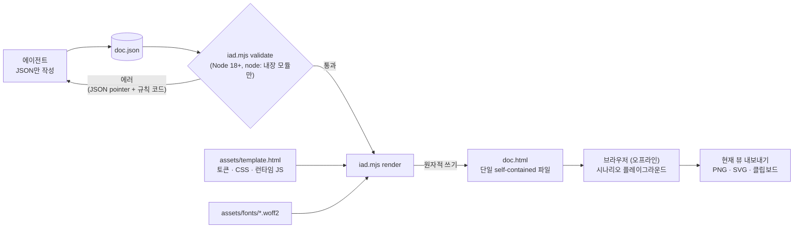

# interactive-architecture-doc

[English](README.md)

시스템 설계를 **단일 파일로 동작하는 인터랙티브 HTML 아키텍처 문서**로 만들어 주는 에이전트 스킬입니다.
TL;DR, 번호가 매겨진 단계(stepper), 주체별 색상 노드, 분기 흐름, 그리고 시나리오를 고르고 단계를 넘겨가며
어떤 박스가 활성화되고 어떤 데이터가 오가는지 보여주는 플레이그라운드를 포함합니다.

에이전트는 HTML을 직접 쓰지 않습니다. JSON 문서를 작성하면 무의존 Node 스크립트가 검증(단계 번호, 분기,
fan 화살표 같은 교차 참조 포함)하고 오프라인에서 열리는 HTML 한 파일로 렌더합니다. 문서 안에서 **현재 뷰**
(선택한 시나리오와 단계)를 PNG, SVG, 클립보드 이미지로 내보낼 수 있고, 라이트/다크 테마와 한국어/영어 UI를 지원합니다.

| 라이트 | 다크 |
|---|---|
|  |  |

## 동작 흐름



- 에이전트는 HTML을 직접 고치지 않습니다. 문제가 있으면 JSON을 고치고 다시 렌더합니다.
- `render`는 검증을 다시 실행하고, 에러가 있으면 파일을 쓰지 않습니다.
- JSON은 HTML 안(`#iad-data`)에 함께 들어가므로 HTML 파일만 있어도 원본을 복원할 수 있습니다.

## 설치

```sh
npx skills add sunjae98/interactive-architecture-doc
```

요구사항: Node.js 18 이상, 에이전트의 셸 접근. 생성된 HTML은 의존성이 없고 더블클릭만으로 오프라인에서 열립니다.

## 사용법

Claude Code에서는 슬래시 명령으로 스킬을 직접 호출합니다.

```text
/interactive-architecture-doc 업로드 파이프라인을 인터랙티브 아키텍처 문서로 만들어줘. 클라이언트가 파일을 보내면
게이트웨이가 이미지/오디오/영상 처리를 판단하고, 외부 검수 서비스를 호출해.
```

슬래시 명령 없이 "인터랙티브 아키텍처 문서 만들어줘"처럼 요청해도 에이전트가 스킬 설명을 보고 이 스킬을
골라 씁니다. 스킬을 지원하는 다른 에이전트도 같은 방식으로 불러오지만, 직접 호출하는 문법은 에이전트마다 다릅니다.

에이전트는 `skills/interactive-architecture-doc/SKILL.md`에 따라 정보를 수집하고, `examples/`에서 가장 가까운
파일을 복사해 `doc.json`을 작성한 뒤 다음을 실행합니다.

```sh
node scripts/iad.mjs validate doc.json   # 에러와 경고를 수정
node scripts/iad.mjs render doc.json     # doc.json 옆에 doc.html 생성
```

`doc.json`은 원본이므로 HTML 옆에 보관하세요. 문서를 고칠 때는 JSON을 수정하고 다시 렌더합니다
(HTML에도 `<script id="iad-data">`로 JSON 사본이 들어 있습니다). 형식은
`skills/interactive-architecture-doc/references/format.md`를 참고하세요.

### 언어 (한국어 / 영어 산출물)

문서 언어는 JSON의 `meta.lang`으로 정합니다. 값은 `"en"`(기본값) 또는 `"ko"`입니다.

| | 영어 산출물 | 한국어 산출물 |
|---|---|---|
| 요청 방법 | 영어로 요청 | 한국어로 요청 (또는 "한국어로 작성해줘") |
| `meta.lang` | `"en"` (생략 가능) | `"ko"` |
| UI 문구 (버튼, 상태, 내보내기 메시지) | 영어 | 한국어 |
| 시작 예시 | `examples/*.en.json` | `examples/*.ko.json` |

- 에이전트는 요청한 언어를 보고 `meta.lang`을 고릅니다. "문서는 한국어로 만들어줘"처럼 명시하면 그대로 따릅니다.
- `meta.lang`은 내장 UI 문구와 페이지의 `<html lang>`만 바꿉니다. 직접 쓰는 본문(제목, 단계,
  노드, 시나리오)은 번역되지 않으므로 같은 언어로 작성해야 합니다.
- 기존 문서의 언어를 바꾸려면 `doc.json`에서 `meta.lang`을 바꾸고 본문을 옮긴 뒤 다시 렌더합니다.

```json
{ "meta": { "title": "요청 라우터", "subtitle": "…", "lang": "ko" } }
```

## 브라우저 지원과 내보내기 제한

- 최신 Chrome에서 문서 보기와 내보내기 전체를 검증했습니다. 다른 최신 브라우저도 표준 기능만 쓰므로 보기는
  동작할 것으로 보이지만 검증하지 않았고, Safari는 테스트하지 않았습니다.
- 내보내기는 SVG `foreignObject`로 페이지를 렌더하므로 브라우저마다 결과가 조금 다를 수 있고, Safari가 가장
  예측하기 어렵습니다(폰트, 이모지, 크기 차이). PNG나 클립보드 내보내기가 실패하면 화면에 메시지가 나오며 SVG
  내보내기를 대안으로 쓰면 됩니다.
- 클립보드 이미지 복사는 보안 컨텍스트(`https://` 또는 `localhost`; `file://`는 브라우저마다 다름)와 클립보드
  권한이 필요하고, 이미지 클립보드 쓰기를 지원하지 않는 브라우저도 있습니다.
- 내보낸 PNG는 약 16메가픽셀로 제한되며, 더 큰 뷰는 축소됩니다.
- 이모지(시나리오 아이콘)는 시스템 이모지 폰트를 쓰므로 플랫폼마다 모양이 다릅니다.

## 폰트와 서드파티

생성된 HTML에는 IAD Sans(Pretendard의 이름을 바꾼 서브셋)와 Geist Mono 폰트가 내장됩니다. 색상과 스케일은 Radix
Colors와 Primer Primitives에서 가져왔습니다. [THIRD_PARTY_NOTICES.md](THIRD_PARTY_NOTICES.md)를 참고하세요.

## 기여

[CONTRIBUTING.md](CONTRIBUTING.md)를 참고하세요. 설계 문서: [docs/plans/v2.md](docs/plans/v2.md).

## 라이선스

MIT, [LICENSE](LICENSE) 참고. 포함된 폰트는 SIL OFL 1.1을 따릅니다.
