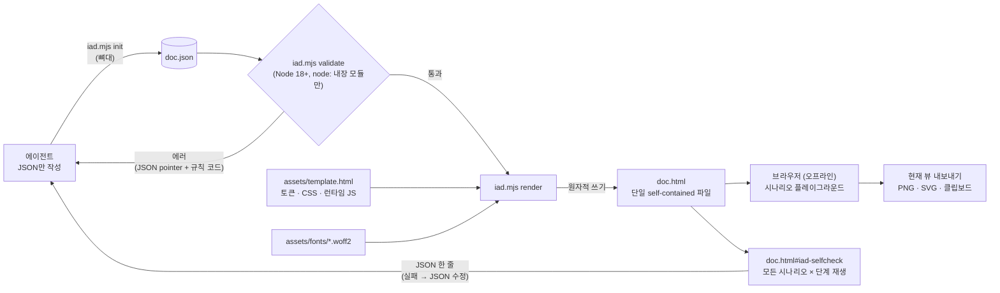

# interactive-architecture-doc

[English](README.md)

코드베이스나 시스템 설계를 **단일 파일로 동작하는 인터랙티브 HTML 아키텍처 문서**로 만들어 주는 에이전트
스킬입니다. **Walkthrough**와 **Overview** 두 가지 형식을 제공합니다.

에이전트는 HTML을 직접 쓰지 않습니다. JSON 문서를 작성하면 무의존 Node 스크립트가 검증(단계 번호, 분기,
연결선, 경로 같은 교차 참조 포함)하고 오프라인에서 열리는 HTML 한 파일로 렌더합니다. 문서 안에서 **현재 뷰**를
PNG, SVG, 클립보드 이미지로 내보낼 수 있고, 라이트/다크 테마와 한국어/영어 UI를 지원합니다.

## 두 가지 형식: Walkthrough와 Overview

| | Walkthrough | Overview |
|---|---|---|
| 용도 | 테크스펙, 설계 리뷰 | 제품 문서, 기능(feature) 페이지, README |
| 보여주는 것 | 요청이 번호 매겨진 단계를 시나리오별로 지나가는 과정, TL;DR, 설계 결정과 그 이유 | 레이어 다이어그램 한 장(클라이언트, 컴포넌트, 외부 서비스)과, 같은 배치에서 경로만 강조하는 탭 |
| 독자가 하는 일 | 시나리오를 고르고 "다음 단계"를 누르며 단계별 데이터를 읽음 | 다이어그램을 읽고, 경로를 바꿔 기능이 어떤 부분을 거치는지 확인 |
| 내보내기 | 현재 시나리오와 단계 | 현재 경로와 테마의 다이어그램 (문서 페이지에 바로 넣을 수 있음) |
| 형식 문서 | [format.md](skills/interactive-architecture-doc/references/format.md) | [format-overview.md](skills/interactive-architecture-doc/references/format-overview.md) |

문서를 요청하면 에이전트가 요청 내용으로 형식을 고릅니다("테크스펙용" → Walkthrough, "공식 문서용" → Overview).
판단할 수 없으면 한 번 물어봅니다. 선택은 JSON의 `meta.style`에 기록되고, 이 값이 없는 문서는 Walkthrough입니다.

**Walkthrough**

| 라이트 | 다크 |
|---|---|
|  |  |

**Overview** (같은 시스템, "Needs a lookup" 경로를 선택한 상태)

| 라이트 | 다크 |
|---|---|
|  |  |

## 동작 흐름



- 에이전트는 HTML을 직접 고치지 않습니다. 문제가 있으면 JSON을 고치고 다시 렌더합니다.
- `render`는 검증을 다시 실행하고, 에러가 있으면 파일을 쓰지 않습니다.
- JSON은 HTML 안(`#iad-data`)에 함께 들어가므로 HTML 파일만 있어도 원본을 복원할 수 있습니다.

## 단일 `SKILL.md` + 템플릿 방식과 비교

이런 스킬은 흔히 `SKILL.md` 하나와 큰 HTML 템플릿으로 만들고, 에이전트가 템플릿을 복사해 손으로 고칩니다.
interactive-architecture-doc은 대신 JSON 형식, 검증기, 렌더러, 브라우저 셀프체크를 제공합니다.

| | 단일 `SKILL.md` + 템플릿 수작업 편집 | interactive-architecture-doc |
|---|---|---|
| 일관성 | 단계 수 / 단계 총합, `data-step` / `data-branch`, fan hub/target 쌍, 시나리오 옵션과 키를 손으로 맞춤 | 모두 하나의 JSON 정의에서 생성 |
| 검증 | 페이지를 클릭해 보며 불일치 발견 | 렌더 전에 JSON pointer와 규칙 코드로 거부 (예: `/board/3 E_FAN_TARGET_NO_HUB`) |
| 확인 | 수동 클릭, 스크린샷 여러 장 | `doc.html#iad-selfcheck`가 모든 시나리오 × 단계를 재생하고 JSON 한 줄로 결과 반환 |
| 에이전트가 읽는 양 | ≈46 KB (`SKILL.md` + 참고 문서 + 약 34 KB HTML 템플릿) | ≈15–21 KB (`SKILL.md` 5.8 KB + `format.md` 7.9 KB + `iad init` 뼈대 1.8–7.2 KB); 템플릿은 렌더러만 사용 |
| 에이전트가 쓰는 양 | HTML ~34 KB 이상 | 작은 JSON 파일 (≈2–12 KB) |
| 수정 | HTML을 다시 손으로 편집 | JSON을 고치고 다시 렌더; JSON이 HTML에 들어 있어 복원 가능 |
| 배포 | 프로젝트마다 폴더 복사 (사본끼리 어긋남) | `npx skills add` / `npx skills update` 한 줄로 설치와 업데이트 |

<picture>
  <source media="(prefers-color-scheme: dark)" srcset="docs/token-comparison-dark.svg">
  
</picture>

- 표의 수치는 파일 크기(바이트)이고, 그래프는 바이트 / 4로 토큰을 추정한 값입니다. 둘 다 정확한 토크나이저
  수치는 아닙니다. 그래프는 `node tools/charts/token-chart.mjs`로 다시 만듭니다.
- 오픈소스 저장소로 관리합니다: 버전별 릴리스와 [CHANGELOG](CHANGELOG.md), Node 18/20/22 CI(테스트, 예제 검증,
  폰트 해시), 개발용 파일(테스트, 폰트 빌드 도구, CI)은 설치되는 스킬 폴더에 들어가지 않습니다.
- 트레이드오프: 에이전트에 Node.js 18 이상과 셸 접근이 필요합니다(템플릿만 쓰는 스킬은 파일 편집만 필요).

## 설치

```sh
npx skills add sunjae98/interactive-architecture-doc
```

요구사항: Node.js 18 이상, 에이전트의 셸 접근. 생성된 HTML은 의존성이 없고 더블클릭만으로 오프라인에서 열립니다.

### 업데이트

설치했던 범위(프로젝트 또는 전역)와 같은 범위로 업데이트합니다.

```sh
npx skills update interactive-architecture-doc       # 프로젝트/전역 중 선택을 물어봄
npx skills update interactive-architecture-doc -p -y # 프로젝트 설치 (프로젝트 루트에서 실행)
npx skills update interactive-architecture-doc -g -y # 전역(사용자) 설치
```

- 스킬 이름을 빼고 `npx skills update`만 실행하면 설치된 스킬 전체를 업데이트합니다.
- 업데이트는 이 저장소의 최신 `main`을 가져옵니다. 바뀐 내용은 [CHANGELOG.md](CHANGELOG.md)를 참고하세요.
- `--copy`로 설치했다면 업데이트 후 `.agents/skills/`를 가리키는 심볼릭 링크로 바뀔 수 있습니다. 복사본을
  유지하려면 대신 다시 설치하세요: `npx skills add sunjae98/interactive-architecture-doc --copy -y`.
- 이미 렌더한 문서는 그대로 동작합니다. 템플릿 변경(테마, 내보내기, self-check)을 반영하려면 업데이트된 스킬로
  `doc.json`을 다시 렌더하세요.

## 사용법

Claude Code에서는 슬래시 명령으로 스킬을 직접 호출합니다.

```text
/interactive-architecture-doc 업로드 파이프라인을 인터랙티브 아키텍처 문서로 만들어줘. 클라이언트가 파일을 보내면
게이트웨이가 이미지/오디오/영상 처리를 판단하고, 외부 검수 서비스를 호출해.
```

Overview를 원하면 다이어그램을 어디에 쓸지 함께 말하면 됩니다.

```text
/interactive-architecture-doc 이 레포의 요청 흐름을 공식 문서에 넣을 overview 다이어그램으로 만들어줘.
```

슬래시 명령 없이 "인터랙티브 아키텍처 문서 만들어줘"처럼 요청해도 에이전트가 스킬 설명을 보고 이 스킬을
골라 씁니다. 스킬을 지원하는 다른 에이전트도 같은 방식으로 불러오지만, 직접 호출하는 문법은 에이전트마다 다릅니다.

에이전트는 `skills/interactive-architecture-doc/SKILL.md`에 따라 정보를 수집하고, 뼈대(또는 minimal 예제)에서
`doc.json`을 시작해 내용을 채운 뒤 다음을 실행합니다.

```sh
node scripts/iad.mjs init doc.json --lang ko --steps 4 --scenarios image,audio --fork   # [자리표시자]가 든 Walkthrough 뼈대
node scripts/iad.mjs init doc.json --style overview --lang ko --paths read,write       # Overview 뼈대
node scripts/iad.mjs validate doc.json   # 에러와 경고를 수정
node scripts/iad.mjs render doc.json     # doc.json 옆에 doc.html 생성 (형식은 meta.style로 결정)
```

결과 확인은 모든 시나리오를 클릭해 보는 대신, 브라우저 도구로 `doc.html#iad-selfcheck`를 열어
`#iad-selfcheck-result`의 JSON 한 줄(`{"ok":true,"checked":21,...,"failures":[]}`)을 읽습니다. 스크린샷은
셀프체크가 실패했을 때만 필요합니다. 같은 URL을 직접 열어 봐도 됩니다.

`doc.json`은 원본이므로 HTML 옆에 보관하세요. 문서를 고칠 때는 JSON을 수정하고 다시 렌더합니다
(HTML에도 `<script id="iad-data">`로 JSON 사본이 들어 있습니다). 형식은
`skills/interactive-architecture-doc/references/format.md`(Walkthrough)와 `references/format-overview.md`
(Overview), 명령은 `references/cli.md`를 참고하세요. Overview는 `doc.html#<경로 id>`로 열면 그 경로가 선택된
상태로 열립니다.

### 언어 (한국어 / 영어 산출물)

문서 언어는 JSON의 `meta.lang`으로 정합니다. 값은 `"en"`(기본값) 또는 `"ko"`입니다.

| | 영어 산출물 | 한국어 산출물 |
|---|---|---|
| 요청 방법 | 영어로 요청 | 한국어로 요청 (또는 "한국어로 작성해줘") |
| `meta.lang` | `"en"` (생략 가능) | `"ko"` |
| UI 문구 (버튼, 상태, 내보내기 메시지) | 영어 | 한국어 |
| 시작점 | `iad init --lang en` 또는 `examples/*.en.json` | `iad init --lang ko` 또는 `examples/*.ko.json` |

- 에이전트는 요청한 언어를 보고 `meta.lang`을 고릅니다. "문서는 한국어로 만들어줘"처럼 명시하면 그대로 따릅니다.
- `meta.lang`은 내장 UI 문구와 페이지의 `<html lang>`만 바꿉니다. 직접 쓰는 본문(제목, 단계,
  노드, 시나리오)은 번역되지 않으므로 같은 언어로 작성해야 합니다.
- 기존 문서의 언어를 바꾸려면 `doc.json`에서 `meta.lang`을 바꾸고 본문을 옮긴 뒤 다시 렌더합니다.

```json
{ "meta": { "title": "요청 라우터", "subtitle": "…", "lang": "ko" } }
```

## 브라우저 지원과 내보내기 제한

- 최신 Chrome에서 문서 보기와 내보내기 전체를 검증했습니다. 다른 최신 브라우저도 표준 기능만 쓰므로 보기는
  동작할 것으로 보이지만 검증하지 않았고, Safari는 테스트하지 않았습니다.
- Overview 내보내기는 다이어그램 자체를 SVG로 저장합니다(스타일, 폰트, 색상 포함). 브라우저, 문서 사이트,
  이미지 뷰어에서 똑같이 보입니다.
- Walkthrough 내보내기는 SVG `foreignObject`로 페이지를 렌더하므로 브라우저마다 결과가 조금 다를 수 있고, Safari가 가장
  예측하기 어렵습니다(폰트, 이모지, 크기 차이). PNG나 클립보드 내보내기가 실패하면 화면에 메시지가 나오며 SVG
  내보내기를 대안으로 쓰면 됩니다.
- 클립보드 이미지 복사는 보안 컨텍스트(`https://` 또는 `localhost`; `file://`는 브라우저마다 다름)와 클립보드
  권한이 필요하고, 이미지 클립보드 쓰기를 지원하지 않는 브라우저도 있습니다.
- 내보낸 PNG는 약 16메가픽셀로 제한되며, 더 큰 뷰는 축소됩니다.
- 이모지(시나리오 아이콘)는 시스템 이모지 폰트를 쓰므로 플랫폼마다 모양이 다릅니다.

## 폰트와 서드파티

생성된 HTML에는 IAD Sans(Pretendard의 이름을 바꾼 서브셋)와 Geist Mono 폰트가 내장됩니다. 색상과 스케일은 Radix
Colors와 Primer Primitives에서 가져왔습니다. [THIRD_PARTY_NOTICES.md](THIRD_PARTY_NOTICES.md)를 참고하세요.

## 기여

[CONTRIBUTING.md](CONTRIBUTING.md)를 참고하세요.

## 라이선스

MIT, [LICENSE](LICENSE) 참고. 포함된 폰트는 SIL OFL 1.1을 따릅니다.
