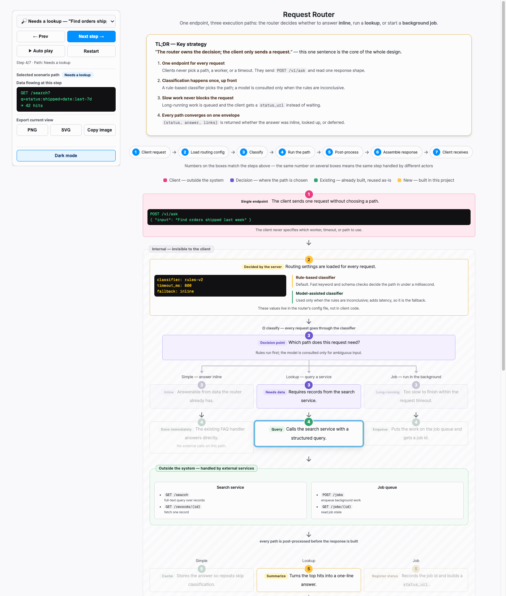
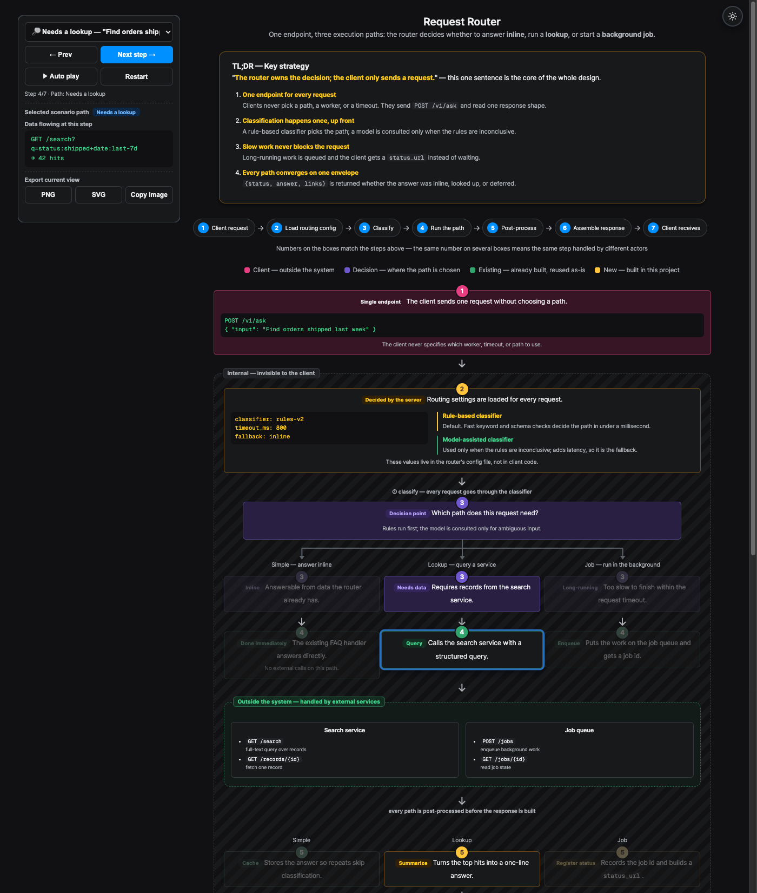
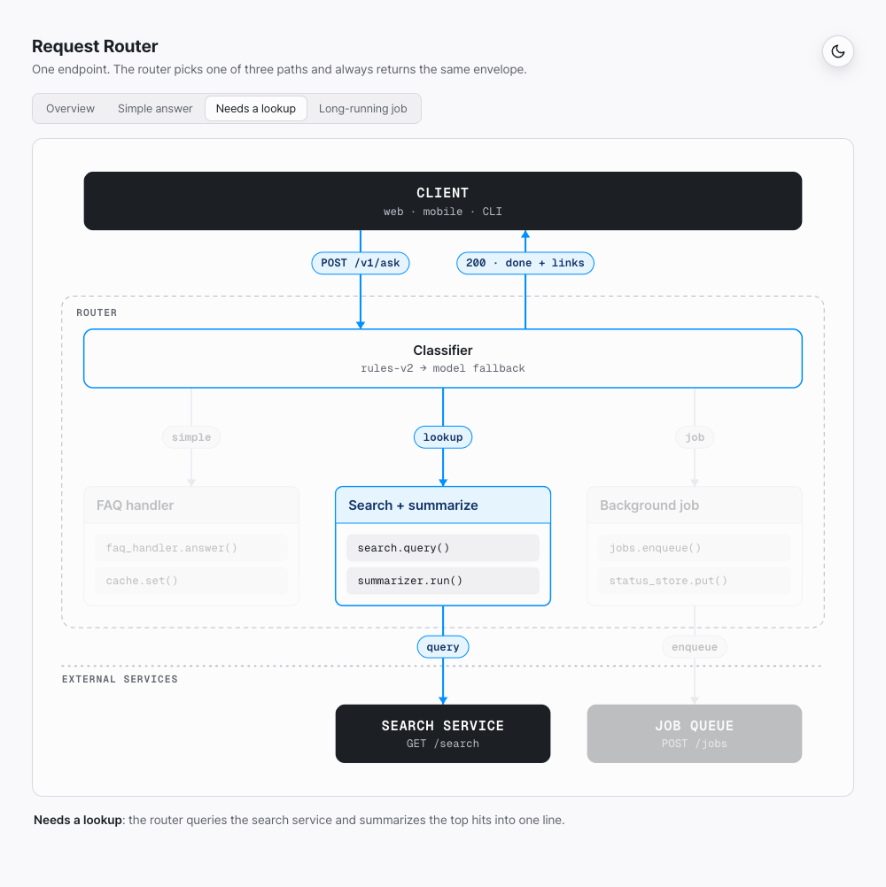
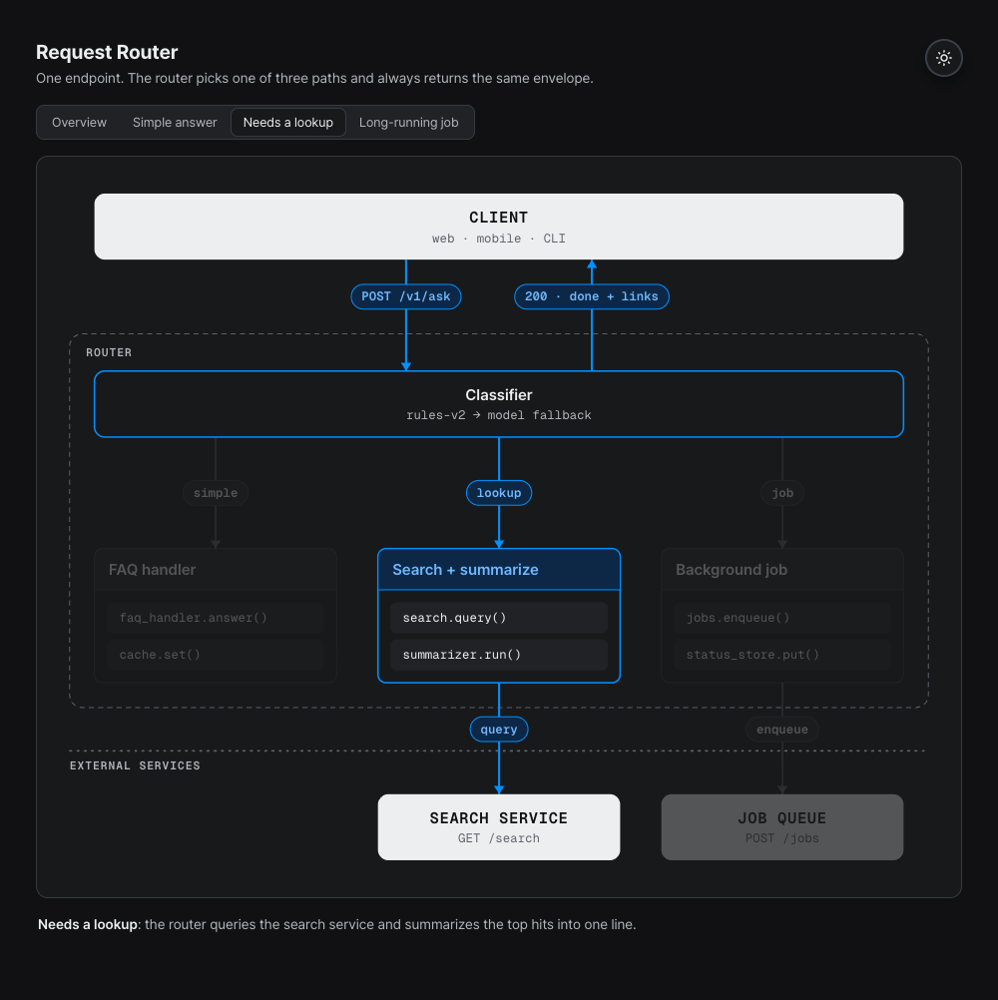
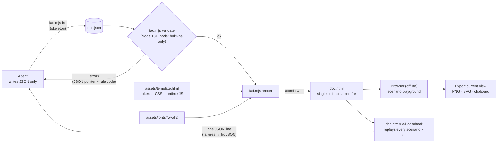
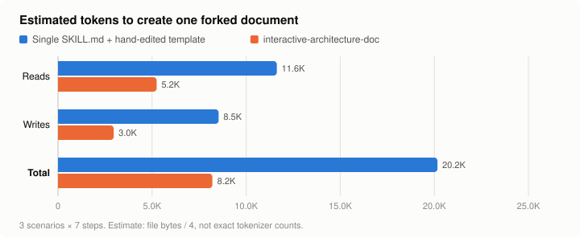

# interactive-architecture-doc

[한국어](README.ko.md)

An agent skill that turns a codebase or a system design into a **self-contained, interactive HTML
architecture document**. It provides two styles, **Walkthrough** and **Overview**.

The agent never writes HTML. It writes a JSON document, a dependency-free Node script validates it
(cross-references such as step numbers, branches, edges and paths are checked), and renders one offline
HTML file. The viewer can export the **current view** as PNG, SVG, or a clipboard image. Light and dark
themes, Korean and English UI.

## Two styles: Walkthrough and Overview

| | Walkthrough | Overview |
|---|---|---|
| For | Tech specs, design reviews | Product docs, feature pages, READMEs |
| Shows | A request stepping through numbered steps, scenario by scenario, with a TL;DR and design decisions ("why this way") | One layered diagram (client, components, external services) with tabs that highlight a path through the same layout |
| Reader does | Picks a scenario, presses "Next step", reads the data at each step | Reads the diagram; switches paths to see which parts a feature uses |
| Export | The current scenario and step | The diagram in the current path and theme, ready to drop into a docs page |
| Format | [format.md](skills/interactive-architecture-doc/references/format.md) | [format-overview.md](skills/interactive-architecture-doc/references/format-overview.md) |

When you ask for a document, the agent picks the style from your request ("for our tech spec" →
Walkthrough, "for the docs" → Overview) and asks you once if it cannot tell. `meta.style` in the JSON records
the choice; documents without it are Walkthrough.

**Walkthrough**

| Light | Dark |
|---|---|
|  |  |

**Overview** (the same system, with the "Needs a lookup" path selected)

| Light | Dark |
|---|---|
|  |  |

## How it works



- The agent never edits HTML. If something is wrong, it fixes the JSON and renders again.
- `render` re-runs validation and refuses to write if there are errors.
- The JSON is embedded in the HTML (`#iad-data`), so the source can be recovered from the HTML file.

## Why not a single `SKILL.md` with a template?

A common way to build this kind of skill is a single `SKILL.md` plus a large HTML template that the agent copies
and edits by hand. interactive-architecture-doc instead gives the agent a JSON format, a validator, a renderer,
and a browser self-check.

| | Single `SKILL.md` + hand-edited template | interactive-architecture-doc |
|---|---|---|
| Consistency | step count / step total, `data-step` / `data-branch`, fan hub/target pairs, scenario options and keys kept in sync by hand | all generated from one JSON definition |
| Validation | mismatches found by clicking through the page | rejected before render with a JSON pointer and rule code, e.g. `/board/3 E_FAN_TARGET_NO_HUB` |
| Verification | manual clicking, many screenshots | `doc.html#iad-selfcheck` replays every scenario × step and returns one JSON line |
| Agent reads | ≈46 KB (`SKILL.md` + reference notes + a ~34 KB HTML template) | ≈15–21 KB (`SKILL.md` 5.8 KB + `format.md` 7.9 KB + `iad init` skeleton 1.8–7.2 KB); the template is used only by the renderer |
| Agent writes | ~34 KB+ of HTML | a small JSON file (≈2–12 KB) |
| Updates | re-edit the HTML | edit the JSON and render again; the JSON is embedded in the HTML and can be recovered |
| Distribution | folder copied into each project (copies drift) | one-line install and updates with `npx skills add` / `npx skills update` |

<picture>
  <source media="(prefers-color-scheme: dark)" srcset="docs/token-comparison-dark.svg">
  
</picture>

- Table figures are file sizes in bytes; the chart estimates tokens as bytes / 4. Neither is an exact
  tokenizer count. Regenerate the chart with `node tools/charts/token-chart.mjs`.
- Maintained as an open-source repository: versioned releases with a [CHANGELOG](CHANGELOG.md), CI on
  Node 18/20/22 (tests, example validation, font hashes), and development files (tests, font build tool, CI)
  kept out of the installed skill folder.
- Trade-off: the agent needs Node.js 18+ and shell access; a template-only skill needs only file editing.

## Install

```sh
npx skills add sunjae98/interactive-architecture-doc
```

Requirements: Node.js 18+ and shell access for the agent. The generated HTML has no dependencies and
opens offline by double-click.

### Update

Run the update in the same scope you installed into:

```sh
npx skills update interactive-architecture-doc       # asks project or global
npx skills update interactive-architecture-doc -p -y # project install (run in the project root)
npx skills update interactive-architecture-doc -g -y # global (user-level) install
```

- Without a skill name, `npx skills update` updates every installed skill.
- The update pulls the latest `main` of this repository. See [CHANGELOG.md](CHANGELOG.md) for what changed.
- If you installed with `--copy`, the update may switch the install to a symlink into `.agents/skills/`.
  To keep a plain copy, reinstall instead: `npx skills add sunjae98/interactive-architecture-doc --copy -y`.
- Documents you already rendered keep working; to pick up template changes (theme, export, self-check),
  render their `doc.json` again with the updated skill.

## Usage

In Claude Code, invoke the skill explicitly with its slash command:

```text
/interactive-architecture-doc Make an interactive architecture document for our upload pipeline: the client
sends a file, the gateway decides between image/audio/video handling, and an external moderation service is called.
```

For an Overview, say where the diagram goes:

```text
/interactive-architecture-doc Make an overview diagram of this repository's request flow for our docs site.
```

You can also just describe what you want ("make an interactive architecture document for …"); the agent picks
the skill from its description. Other agents that support skills load it the same way, but the explicit
invocation syntax depends on the agent.

The agent follows `skills/interactive-architecture-doc/SKILL.md`: it gathers the details, starts `doc.json`
from a skeleton (or the minimal example), fills it in, and runs

```sh
node scripts/iad.mjs init doc.json --lang en --steps 4 --scenarios image,audio --fork   # Walkthrough skeleton with [placeholders]
node scripts/iad.mjs init doc.json --style overview --paths read,write                  # Overview skeleton
node scripts/iad.mjs validate doc.json   # fix reported errors and warnings
node scripts/iad.mjs render doc.json     # writes doc.html next to doc.json (style from meta.style)
```

To check the result, it opens `doc.html#iad-selfcheck` in a browser tool and reads one JSON line from
`#iad-selfcheck-result` (`{"ok":true,"checked":21,...,"failures":[]}`) instead of clicking through every
scenario; screenshots are only needed when the self-check fails. You can open the same URL yourself.

Keep `doc.json` next to the HTML: it is the source. To update a document, edit the JSON and render again
(the HTML also embeds a copy of the JSON in `<script id="iad-data">`). The formats are described in
`skills/interactive-architecture-doc/references/format.md` (Walkthrough) and `references/format-overview.md`
(Overview), the commands in `references/cli.md`. An Overview opens on a path with `doc.html#<path-id>`.

### Language (Korean / English output)

The document language is set by `meta.lang` in the JSON: `"en"` (default) or `"ko"`.

| | English output | Korean output |
|---|---|---|
| How to ask | Write your request in English | Write your request in Korean (or say "write it in Korean") |
| `meta.lang` | `"en"` (or omit) | `"ko"` |
| UI strings (buttons, status, export messages) | English | Korean |
| Starting point | `iad init --lang en` or `examples/*.en.json` | `iad init --lang ko` or `examples/*.ko.json` |

- The agent picks `meta.lang` from the language of your request; you can always override it explicitly
  ("make the document in Korean").
- `meta.lang` only switches the built-in UI strings and the page's `<html lang>`.
  The text you write (titles, steps, nodes, scenarios) is never translated, so write it in the same language.
- To switch an existing document, change `meta.lang` (and translate the text) in `doc.json`, then render again.

```json
{ "meta": { "title": "요청 라우터", "subtitle": "…", "lang": "ko" } }
```

## Browser support and export limits

- Tested in current Chrome (viewing and all exports). Other modern browsers use only standard features for
  viewing and are expected to work, but are not verified; Safari was not tested.
- Overview export writes the diagram itself as SVG (styles, fonts and colors inlined), so it renders the
  same in browsers, docs sites and image viewers.
- Walkthrough export renders the page through an SVG `foreignObject`. Output can differ slightly between browsers;
  Safari is the least predictable (fonts, emoji, and sizing may differ). If PNG or clipboard export fails,
  the document shows a message and the SVG export is the fallback.
- Copying an image to the clipboard needs a secure context (`https://` or `localhost`; `file://` support
  varies by browser) and the browser's clipboard permission. Not every browser supports image clipboard writes.
- Exported PNGs are capped at about 16 megapixels; very large views are scaled down.
- Emoji (scenario icons) use the system emoji font, so they look different per platform.

## Fonts and third-party code

Fonts are embedded in the generated HTML: IAD Sans (a renamed subset of Pretendard) and Geist Mono. Colors
and scales derive from Radix Colors and Primer Primitives. See [THIRD_PARTY_NOTICES.md](THIRD_PARTY_NOTICES.md).

## Contributing

See [CONTRIBUTING.md](CONTRIBUTING.md).

## License

MIT, see [LICENSE](LICENSE). Bundled fonts are under the SIL OFL 1.1.
