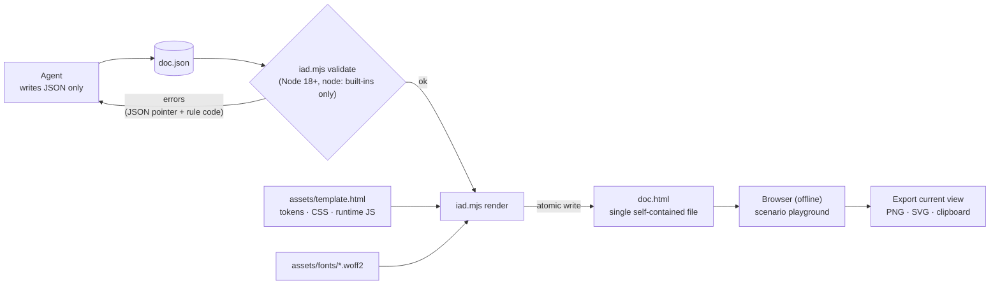

# interactive-architecture-doc

[한국어](README.ko.md)

An agent skill that turns a system design into a **self-contained, interactive HTML architecture document**:
a TL;DR, numbered steps, color-coded nodes, branching flows, and a scenario playground where the reader
steps through a request and sees which boxes activate and what data flows at each step.

The agent never writes HTML. It writes a JSON document, a dependency-free Node script validates it
(cross-references such as step numbers, branches, and fan arrows are checked), and renders one offline
HTML file. The viewer can export the **current view** (selected scenario and step) as PNG, SVG, or a
clipboard image. Light and dark themes, Korean and English UI.

| Light | Dark |
|---|---|
|  |  |

## How it works



- The agent never edits HTML. If something is wrong, it fixes the JSON and renders again.
- `render` re-runs validation and refuses to write if there are errors.
- The JSON is embedded in the HTML (`#iad-data`), so the source can be recovered from the HTML file.

## Install

```sh
npx skills add sunjae98/interactive-architecture-doc
```

Requirements: Node.js 18+ and shell access for the agent. The generated HTML has no dependencies and
opens offline by double-click.

## Usage

In Claude Code, invoke the skill explicitly with its slash command:

```text
/interactive-architecture-doc Make an interactive architecture document for our upload pipeline: the client
sends a file, the gateway decides between image/audio/video handling, and an external moderation service is called.
```

You can also just describe what you want ("make an interactive architecture document for …"); the agent picks
the skill from its description. Other agents that support skills load it the same way, but the explicit
invocation syntax depends on the agent.

The agent follows `skills/interactive-architecture-doc/SKILL.md`: it gathers the details, copies the closest
file from `examples/`, writes `doc.json`, and runs

```sh
node scripts/iad.mjs validate doc.json   # fix reported errors and warnings
node scripts/iad.mjs render doc.json     # writes doc.html next to doc.json
```

Keep `doc.json` next to the HTML: it is the source. To update a document, edit the JSON and render again
(the HTML also embeds a copy of the JSON in `<script id="iad-data">`). The format is described in
`skills/interactive-architecture-doc/references/format.md`.

### Language (Korean / English output)

The document language is set by `meta.lang` in the JSON: `"en"` (default) or `"ko"`.

| | English output | Korean output |
|---|---|---|
| How to ask | Write your request in English | Write your request in Korean (or say "write it in Korean") |
| `meta.lang` | `"en"` (or omit) | `"ko"` |
| UI strings (buttons, status, export messages) | English | Korean |
| Starting example | `examples/*.en.json` | `examples/*.ko.json` |

- The agent picks `meta.lang` from the language of your request; you can always override it explicitly
  ("make the document in Korean").
- `meta.lang` only switches the built-in UI strings and the page's `<html lang>`.
  The text you write (titles, steps, nodes, scenarios) is never translated, so write it in the same language.
- To switch an existing document, change `meta.lang` (and translate the text) in `doc.json`, then render again.

```json
{ "meta": { "title": "요청 라우터", "subtitle": "…", "lang": "ko" } }
```

## Browser support and export limits

- Tested in current Chrome (viewing and all exports). Other modern browsers use only standard features for
  viewing and are expected to work, but are not verified; Safari was not tested.
- Export renders the page through an SVG `foreignObject`. Output can differ slightly between browsers;
  Safari is the least predictable (fonts, emoji, and sizing may differ). If PNG or clipboard export fails,
  the document shows a message and the SVG export is the fallback.
- Copying an image to the clipboard needs a secure context (`https://` or `localhost`; `file://` support
  varies by browser) and the browser's clipboard permission. Not every browser supports image clipboard writes.
- Exported PNGs are capped at about 16 megapixels; very large views are scaled down.
- Emoji (scenario icons) use the system emoji font, so they look different per platform.

## Fonts and third-party code

Fonts are embedded in the generated HTML: IAD Sans (a renamed subset of Pretendard) and Geist Mono. Colors
and scales derive from Radix Colors and Primer Primitives. See [THIRD_PARTY_NOTICES.md](THIRD_PARTY_NOTICES.md).

## Contributing

See [CONTRIBUTING.md](CONTRIBUTING.md). Design notes: [docs/plans/v2.md](docs/plans/v2.md).

## License

MIT, see [LICENSE](LICENSE). Bundled fonts are under the SIL OFL 1.1.
